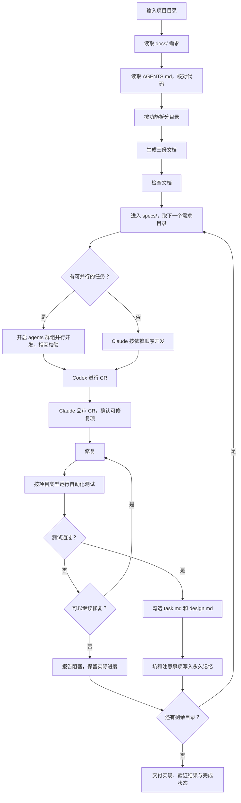

输入：

$ARGUMENTS

第一个参数为目标目录，其余为补充说明。读取目标目录 `docs/` 中的需求和 `AGENTS.md` 中的技术背景，按独立功能在 `specs/` 下建目录，每个目录生成且仅生成 `requirements.md`、`design.md`、`task.md`，然后逐个目录开发直到交付。使用中文。



## 流程

1. **读取需求**：读取 `docs/` 下所有 Markdown（含子目录），区分需求文档和技术资料。目录无效或没有需求文档时询问，不编造内容。
2. **读取 AGENTS.md，核对代码**：读取 `AGENTS.md` 及其引用的文档，再用项目结构和依赖配置核对。`AGENTS.md` 不存在时询问是否继续，继续则以实际代码为准并标注缺失；`AGENTS.md` 描述的模块在代码中已不存在（或反之）时，记录差异并以实际代码为准。
3. **按功能拆分目录**：按可独立验收的功能建目录，需求涉及多端时按端拆分。服务端能力（数据模型、接口、第三方 API 接入）单独成目录且编号最前，Web 端、App 端各成一个目录并依赖它，例如 `01-github-api/`、`02-web-github-admin/`、`03-native-github-list/`。共享能力（如数据模型、共享校验）只归属一个目录，其他目录用相对链接引用。
4. **生成三份文档**：写入前检查 `specs/`。同一来源的目录增量更新，保持目录名、编号和完成状态；`docs/` 中的需求已被替换、旧目录不再有对应需求时，询问是否删除旧目录，不擅自保留或删除；来源不明时询问，不覆盖其他工作。不修改 `docs/` 和 `AGENTS.md`，不生成其他文件。
5. **检查文档**：按「交付前检查」核对编号、链接、依赖和技术背景。同时检查本机是否具备开发与测试所需的环境（Node 版本、数据库、浏览器、App 模拟器或真机、Codex CLI），缺失项写入对应 `task.md` 并标为阻塞。
6. 检查完成后直接进入「开发过程」。待确认项影响实现时先询问，不影响的按标注的假设继续。

## requirements.md

- 写明目标、用户、范围和非目标。
- 需求编号 `REQ-001`，单一行为的子需求编号 `REQ-001.01`。
- 每项写明业务规则、触发条件、预期结果、异常边界和可验证的验收条件，不写“功能正常”这类泛化描述。
- 只拆分需求文档涉及的内容，不扩大范围。缺失或含糊的信息列为待确认项，假设要明确标注。

## design.md

开头写「技术背景」，只列与本功能相关的技术栈、目录结构、架构分层、编码规范、测试命令和可复用模块，每条注明来源文件。

设计项编号 `DES-001`，复杂项可拆为 `DES-001.01`：

```markdown
- [ ] DES-001 用户登录（关联 REQ-001）
  - 实现方案：……
  - 涉及文件：……（新文件标注“新增”）
  - 接口与数据变化：……
  - 验证方式：……
  - 完成证据：待开发
```

- 优先复用现有模块，写实际文件路径。引入 AGENTS.md 和现有依赖之外的技术时，说明理由并列为待确认项。
- `AGENTS.md` 与代码或需求不一致时，记录差异并列为待确认项，不擅自取舍。

## task.md

- 按依赖顺序拆分任务，编号 `TASK-001`，子任务编号 `TASK-001.01`，使用 `- [ ]`。
- 每项写明关联的 `REQ` 和 `DES`、具体工作、涉及文件、前置依赖和验证方式。跨目录依赖写明任务编号和链接。

## 开发过程

进入 `specs/`，按编号和跨目录依赖逐个处理需求目录，每个目录走完以下步骤后再处理下一个，直到全部完成。生成文档时不勾选任何项。

1. **开发**：Claude 按 `task.md` 的依赖顺序开发，遵循 `design.md` 的技术背景和设计项。
2. **并行**：互不依赖且不改同一文件的任务，开启 agents 群组并行开发，各自使用独立 worktree。完成后每个 agent 对照 `REQ` 和 `DES` 校验另一个 agent 的改动，再由 Claude 合并。
3. **Codex CR**：本目录开发完成后，Claude 在会话中执行 `/codex:review` 审查改动。该命令不可用时停下来报告，不跳过。
4. **品审与修复**：Claude 对 CR 结果做一轮品审，逐条核实问题是否成立、是否可修复，只修复确认的问题；不修复的项在 `task.md` 注明理由。
5. **自动化测试**：根据代码判断项目类型，优先使用 `AGENTS.md` 中的测试命令和项目已有的测试框架，覆盖本目录的验收条件。未运行的测试不算通过。
   - 网页：浏览器端到端测试。
   - App：模拟器或真机上的 UI 测试。
   - 后端：接口测试和集成测试。
6. **勾选**：测试通过后勾选 `task.md`，记录改动文件和测试结果。设计项的关联任务全部完成后，勾选 `design.md` 并填写完成证据，不能只更新 `task.md`。
7. **失败处理**：测试失败时保持 `[ ]` 并记录问题，能修复就修复后重新测试。无法修复时报告阻塞，保留实际进度，跳过依赖它的目录，继续其余目录。
8. **永久记忆**：开发中遇到的坑或值得注意的问题，随时写入 Claude 永久记忆，内容包括现象、原因和处理方式。
9. **需求变化**：已完成的实现不再满足验收时，重新打开相关任务，取消对应设计项的勾选并说明原因。

## 交付前检查

- 每项需求都有对应的设计和任务，编号唯一且更新时不变，链接有效，依赖无循环。
- 每份 `design.md` 都有注明来源的技术背景，涉及的已有文件真实存在。
- 全部目录处理完后，简要返回各目录的完成状态、测试结果、阻塞和待确认项，不在聊天中展示文档内容。
