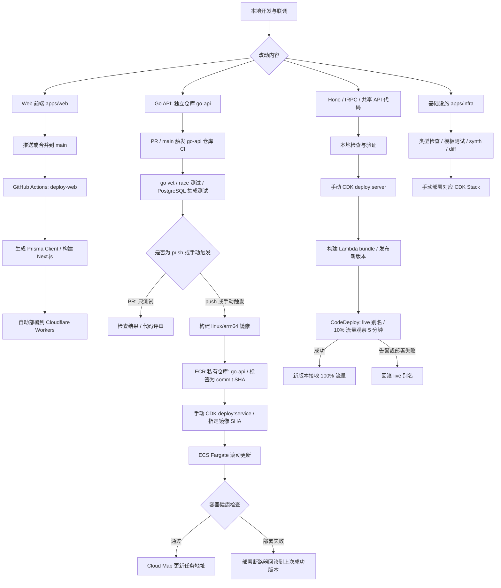
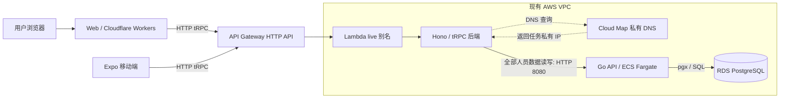

# 当前开发与发布流程

以下根据仓库中的工作流、CDK Stack 和 `cdk.json` 绘制，描述当前代码配置；未检查 AWS 或 Cloudflare 的实际部署状态。

## 开发与发布

- **Go CI 触发条件**：PR 或指定分支的 push 须匹配 Go API、Prisma 迁移或该 CI 文件的路径过滤；也可手动运行。PR 不推镜像。`feat/go-api` 是临时构建分支。
- **当前镜像构建路径**：GitHub Actions 使用限定到 `go-api` 仓库的 IAM 用户凭证推送镜像。`githubActionsPushUser=true`，属于 CodeBuild 配额到位前的过渡方案。
- **CodeBuild 后续路径**：代码仍配置了 `main` 上 Go API 改动触发 CodeBuild，经 CodeConnections 拉代码、测试、构建并推送 ECR。配额可用后按项目说明移除 GitHub 镜像任务、密钥和临时 IAM 用户；这条路径也不会自动部署 ECS。
- **发布是独立步骤**：镜像进入 ECR 后，仍须指定 SHA 执行 `deploy:service`；当前未配置 Go API 或 Lambda 的自动部署工作流。
- **Lambda 首次创建**不经过灰度；后续版本发布才使用 `live` 别名灰度。API Gateway 集成须已切到新函数的 `live` 别名，才会经过这套发布链路。
- **数据库改动**：在 Prisma schema 中修改模型、生成并提交迁移；在能访问目标数据库的环境单独执行迁移，再部署依赖它的服务。镜像构建不会自动迁移生产数据库。

## 运行时调用

`serverGoApiUrl` 当前配置为 `http://go-api.github-name.internal:8080`，部署时映射为 Lambda 的 `GO_API_URL`。未设置该值时，后端改用 Prisma 直连数据库。Cloud Map 只负责发现地址，业务请求由 Lambda 直接发到 Go 任务，不经过 ALB。

API Gateway 是否已从旧函数切到 `github-name-backend:live`，须在 AWS 检查；迁移步骤见 [基础设施 README](README.md)。

## 常用操作

在仓库根目录运行：

| 操作 | 命令 |
| --- | --- |
| 本地 Web | `pnpm dev:web` |
| 本地 Hono 后端 | `pnpm dev:server` |
| 本地 Go 服务 | `pnpm --filter go-api start:local` |
| 本地移动端 | `pnpm dev:native` |
| 检查基础设施类型 | `pnpm --filter infra check-types` |
| 运行基础设施模板测试 | `pnpm --filter infra test` |
| 生成 / 比较基础设施模板 | `pnpm --filter infra synth` / `pnpm --filter infra diff` |
| 部署 Go 指定镜像 | `pnpm --filter infra deploy:service -- -c goApiImageTag=<commit-sha>` |
| 构建并部署 Lambda | `pnpm --filter infra deploy:server` |

本地 Hono 联调本地 Go 时，将 `GO_API_URL` 设为 `http://localhost:8080`；Cloud Map 私有域名用于 VPC 内调用。
